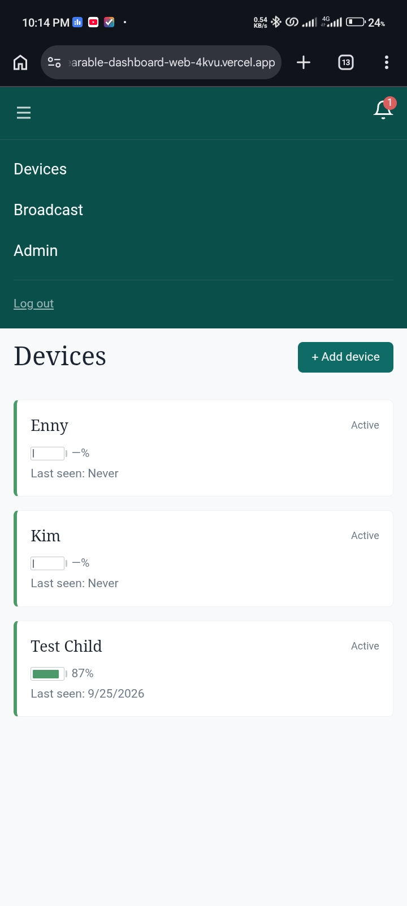

# Child Wearable Notification Bracelet

A Wi-Fi wristband that lets caregivers in a care facility monitor children and tell each child what is expected of them, such as meal time, bath time or sleep time, wherever they are: caregivers send a clear visual cue with a short message from any browser, the bracelet beeps or buzzes to get the child's attention, and a dashboard tells staff when a bracelet goes offline.

I designed the system architecture, the schematic and the PCB layout, and the caregiver dashboard that goes with it.

> Tools: KiCad, ESP32-S3, MQTT, Next.js · Manufacturing target: JLCPCB


## Highlights

- **Messages on the wrist:** a caregiver picks a child, uploads an image with an optional caption, and it fills the bracelet's 1.69 inch screen with an alert.
- **No app, no pairing:** the bracelet joins the facility's own Wi-Fi and the caregiver uses any phone, tablet or laptop browser, so there is nothing to install.
- **Built-in presence monitoring:** every bracelet checks in regularly, and the dashboard raises an alert showing the child's name, last battery level and last contact time if one goes quiet.
- **Two power strategies:** a 5 minute deep-sleep mode for the longest battery life, or modem sleep for near-instant delivery.
- **Hardware low-battery cutoff:** a nanopower comparator shuts the 3.3 V rail down at about 3.4 V, without depending on firmware.
- **Two independent security layers:** admin-approved caregiver logins on the dashboard, and separate per-bracelet credentials on the MQTT broker with topic-level access control.

## How it works

A message travels from the caregiver's browser to the child's wrist through a cloud relay, so the caregiver does not need to be in the same room or building.

1. The caregiver selects a bracelet on the dashboard, uploads an image with an optional caption and taps Send.
2. The dashboard resizes the image to 240 x 280 px JPEG, uploads it to cloud storage and gets a URL.
3. The dashboard publishes an MQTT message with the image URL, caption and a message ID (QoS 1, retained).
4. The bracelet wakes, or receives it instantly in modem sleep mode, connects to the broker and gets the message.
5. The firmware compares the message ID with the last one stored in flash, and only continues if it is new.
6. The bracelet downloads the JPEG over HTTPS, decodes it to RGB565 and pushes it to the display over SPI.
7. The bracelet alerts the child, and the image stays on screen for 60 seconds before the idle screen (name and time) returns.
8. The bracelet publishes a delivery acknowledgement, and the dashboard shows the message as delivered.
9. The message ID is saved to flash and the bracelet goes back to sleep.

### Setup and reset

On first power-up the bracelet starts its own temporary Wi-Fi network. The caregiver connects to it from any phone or laptop, a setup page opens in the browser, and they enter the facility Wi-Fi details and the child's name. A recessed reset button, only reachable with a pen tip, clears the stored setup so the bracelet can be given to another child.

### Presence and low battery

Every wake cycle the bracelet publishes a status heartbeat. If the broker stops hearing from it, the MQTT Last Will fires and the dashboard raises an alert with the child's name, last battery level and time of last contact, after a grace period that avoids false alarms from a brief router hiccup. When the battery is low, both the bracelet's display and the dashboard tell staff to collect it for charging.

## Hardware

Everything sits inside the bracelet enclosure. The only thing the facility provides is its existing Wi-Fi router.

### Schematic

[](Docs/Child%20wereable%20Schematic.svg)

### PCB renders

| Front | Back |
| --- | --- |
|  |  |

### Display


### Components

| Block | Part | Role |
| --- | --- | --- |
| Microcontroller | ESP32-S3-WROOM-1-N8R8 | Runs the firmware, Wi-Fi, display, sleep and wake cycles. Antenna is integrated in the module. |
| Display | ER-TFT1.69-3, 1.69 inch IPS, 240 x 280, ST7789V | Shows images, name, time and battery status over 4-wire SPI, through an FPC connector. |
| Charger | BQ24074RGT | Charges the LiPo cell from a 5 V input and powers the system, with a charge status line to the MCU. |
| Battery | 400 mAh single-cell LiPo, 3.7 V | Main energy source. |
| 3.3 V regulator | AP2112K-3.3 | Converts the battery voltage to a stable 3.3 V rail. Its enable pin is driven by the low-battery comparator. |
| Fuel gauge | MAX17048G+T10 | Reports battery percentage over I2C, with an alert line to the MCU. |
| Low-battery cutoff | TLV3691IDCKR comparator | Shuts the 3.3 V rail down at low battery and restores it after recharge, with hysteresis. |
| Backlight drive | AO3400A MOSFET + 8.2 ohm resistor | MCU PWM on one pin dims the backlight. |
| Alert | Linear resonant actuator (vibration motor) + AO3400A + 1N4148W | Vibrates on a new message. The diode protects the MOSFET from the motor's flyback. |
| Factory reset | TS-1187A-B-A-B recessed switch | Long press clears setup data and reboots into setup mode. |
| Programming | Tag-Connect TC2030 | Flash and debug without a header on the board. |

### Pin assignments

| Function | GPIO | Net |
| --- | --- | --- |
| Display data (MOSI) | GPIO4 | SDA_Display |
| Display clock | GPIO6 | SCL_Display |
| Display chip select | GPIO7 | CS_Display |
| Display data / command | GPIO8 | RS |
| Display reset | GPIO9 | RESET_Display |
| Charger status input | GPIO5 | CHG_Status |
| Backlight drive | GPIO10 | Backlight |
| Fuel gauge I2C data | GPIO11 | I2C_SDA |
| Fuel gauge I2C clock | GPIO12 | I2C_SCL |
| Fuel gauge alert | GPIO13 | MAX17048_ALERT |
| Vibration motor | GPIO14 | Motor drive |
| Factory reset button | GPIO16 | FACTORY_RESET |
| Boot mode | GPIO0 | BOOT |
| Programming / debug | GPIO43 / GPIO44 | UART_TX / UART_RX |

## Engineering decisions

### Wi-Fi and MQTT instead of Bluetooth

Bluetooth Low Energy would have been the best fit for a small wearable, because its very low power consumption gives the longest battery life. I chose Wi-Fi because range mattered more to me than the extra uptime BLE brings. BLE would need the caregiver's phone or a gateway near the child at all times, while Wi-Fi relies on the facility's existing router, which already exists almost everywhere. That gives whole-building coverage with no new infrastructure, so the bracelet works anywhere a phone gets Wi-Fi. The trade-off is shorter battery life, which is why the design offers a deep-sleep mode.

### The image travels by URL, not through MQTT

MQTT is built for small messages, not image files. The message carries only the image URL and the bracelet downloads the JPEG over HTTPS. That keeps MQTT light and makes the pre-loaded image library possible.

### A display that runs straight from the battery

I rejected a Newhaven 1.5 inch display because its backlight needs a boost converter of up to 14 V, a heavy power-design burden on a battery wearable. The ER-TFT1.69-3 backlight runs directly from the battery.

### Charger set for a small cell

The BQ24074 fast-charge current is set by a 4.7 k resistor on ISET, about 189 mA, close to C/2 for the 400 mAh cell. Pre-charge is set automatically at about 19 mA for a deeply discharged cell. The 3.3 k ILIM resistor and the EN1 high / EN2 low setting follow the datasheet for a 500 mA maximum input.

### Low-battery cutoff in hardware

A TLV3691 nanopower comparator watches the battery through a resistor network with 20 M feedback for hysteresis, and drives the enable pin of the AP2112K regulator. The 3.3 V rail shuts down when the battery falls below about 3.4 V and comes back after recharge. Protection does not depend on firmware, so a firmware crash cannot drain the cell past safe levels.

## Connectivity and firmware

### Communication stack

| Layer | Technology | Purpose |
| --- | --- | --- |
| Physical | Wi-Fi 802.11 b/g/n, 2.4 GHz | Bracelet to the facility router |
| Security | TLS 1.2 on port 8883 | Encrypts all traffic |
| Messaging | MQTT v3.1.1 on HiveMQ Cloud | Lightweight messages, QoS 1 delivery, retained messages, Last Will |
| Image delivery | HTTPS GET | The bracelet fetches the image by URL |
| Setup | Wi-Fi SoftAP + captive portal | One-time setup from any phone or laptop |

### Firmware modules (ESP32-S3)

| Module | Responsibility |
| --- | --- |
| Boot manager | Checks stored setup data and routes to setup mode or normal boot. Detects the factory reset hold. |
| SoftAP provisioning | Runs the temporary access point and captive portal, and stores the Wi-Fi details and device name. |
| Wi-Fi / MQTT manager | Connects to the router and broker, handles retries, TLS, Last Will and status publishing. |
| Wake / sleep manager | Controls the deep-sleep timer or modem sleep mode. One wake cycle handles both the heartbeat and the message check. |
| Image handler | Downloads the JPEG, decodes it to RGB565, renders it, and manages the pre-loaded image slots. |
| Display driver | Initialises the ST7789V over SPI, draws images, text and the idle screen, controls backlight PWM and display sleep. |
| Fuel gauge driver | Reads the battery percentage over I2C and adds it to the status message. |
| NVS manager | Stores Wi-Fi details, device name, the last message ID and the pre-loaded image data. |

### Two power strategies

The design offers two modes, switchable by a firmware update, because different deployments value different things.

| | 5 minute deep sleep | Modem sleep |
| --- | --- | --- |
| How it works | Wakes every 5 minutes, connects, checks for messages, publishes status, sleeps | Stays awake, Wi-Fi radio dozes between router beacons, MQTT connection stays alive |
| Message delivery | Up to 5 minutes | Within seconds |
| Out-of-range detection | Up to 5 minutes | Under 2 minutes |
| Estimated runtime, 1 to 2 messages per hour | about 30 to 33 hours | about 14 to 15 hours |
| Best for | Longest battery life | Instant delivery, daily charging |

### Reliability

- **Wake randomisation:** each bracelet's timer is offset by a random value at setup, so 20 bracelets do not all hit the router at once.
- **QoS 1 and retained messages:** the broker retries unacknowledged messages and holds the latest one until the bracelet reconnects.
- **Wi-Fi retry:** the firmware retries the connection up to 3 times and then shows a no-connection indicator, so it never needs a manual restart.

## Caregiver dashboard

It is a monorepo (Next.js with pnpm workspaces and Turborepo) that keeps each function in its own package, with Supabase (Postgres and Storage) for accounts and images and HiveMQ Cloud as the MQTT broker.

| Devices | Broadcast to a child |
| --- | --- |
|  |  |

### Security

Two independent layers protect the system, so compromising one does not expose the other.

| Layer | How it works |
| --- | --- |
| Dashboard login | Caregivers sign in with email and password and receive a signed JWT. New accounts need administrator approval, and an administrator can revoke access immediately. |
| MQTT broker | Each bracelet has its own client ID, username and password, and the broker's access control list limits each set of credentials to its own topics. |

All connections, from browser to backend, backend to broker and bracelet to broker, use TLS 1.2 on port 8883. A compromised bracelet credential affects only that bracelet.

## Repository layout

```text

├── Child wereable.kicad_pro / .kicad_sch / .kicad_pcb   KiCad project
├── fp-lib-table, sym-lib-table                          Project library tables
├── 3D models/                                           STEP models for the parts
├── Footprint/                                           Custom footprints (.pretty libraries)
├── Symbol/                                              Custom symbols (.kicad_sym)
├── Child wereble Fabrication files/
│   ├── Bom.csv, designators.csv, CPL_positions.csv      Assembly data
│   ├── Child wereable Bill of material.csv              Full bill of materials
│   ├── netlist.ipc                                      IPC netlist
│   ├── Child_wereable.zip                               (Gerbers) 
│   ├── PCB 3D model/                                    Board STEP model
│   └── PDFs/                                            Front/back fab and schematic PDFs
├── Docs/
│   ├── Child Wearable System Architecture.pdf           System architecture document
│   ├── System-architecture-clarifications.pdf           
│   ├── Schematic.pdf                                    Schematic (PDF)
│   ├── Child wereable Schematic.svg                     Schematic (SVG, shown in this README)
│   ├── Front Fab.pdf, Back Fab.pdf                      Front and back fabrication drawings
│   ├── Front of wereable watch.png                      Front PCB render
│   ├── Back of wereable watch .png                      Back PCB render
│   ├── 1.69 inch display.png                            Display photo
│   ├── Devices.jpeg                                     Dashboard: devices page
│   ├── Broadcast child.jpeg                             Dashboard: broadcast page
│   ├── dashboard.png                                    Dashboard screenshot
│   └── Childcare website screnshot.png                  Childcare website screenshot
└── README.md
```

## Author

Hakeem Oyebisi · [oyebisihakeem@gmail.com](mailto:oyebisihakeem@gmail.com) · [GitHub](https://github.com/oyeniyihakeem08-blip)
